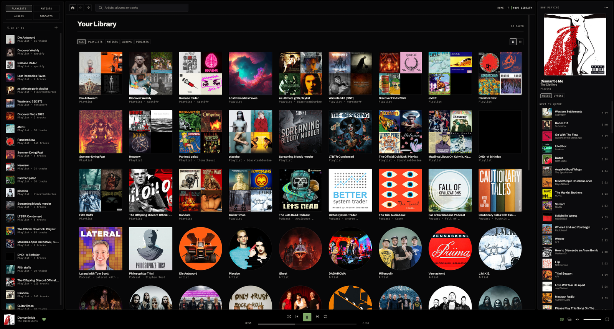

# Takofy

A fast, lean Spotify client for Windows and Linux, in Rust. One binary, no
Electron, no web view. Your library is drawn from a local cache the moment the
window opens, and replaced by the real thing as the network answers.



## Features

Spotify Connect in both directions: send the sound to your phone or a speaker,
or let the phone play through this window. The row it lands on is the row it
keeps playing.

- Radio from anything. A track, an album, an artist or a playlist starts a
  station, and a queue that reaches its end keeps going from what it has just
  played.
- Editing without leaving the window. Drag a row to reorder, drag a playlist to
  the sidebar to move it, press Delete to remove, click the heart to like. A
  row's menu has the rest: add to a playlist or the queue, open the album or the
  artist, copy the link.
- Your playlists, albums, artists, shows and Liked Songs in a three-column
  window that gives up columns as it narrows, down to a drawer for the sidebar.
- Artist pages carry the discography and the artists it is heard with. Shows
  list their episodes, albums their tracks.
- Library filters for playlists, artists, albums and podcasts, and the same set
  as a grid or a list.
- Search answers tracks, then names the albums and artists those tracks came
  from.
- A Now Playing panel with the queue and the lyrics, following the current line
  when the track carries timings.
- Transport with drag-to-seek, shuffle, and repeat off, all or one. The queue is
  reorderable by dragging.
- Make playlists. Follow artists.
- Every cover is fetched at the size its box draws it, so a full-width band is
  not a stretched thumbnail.

## Installing

There is no package in any distribution's repository yet — that is
[#57](https://github.com/Tako88/takofy/issues/57). A release tag carries a
Flatpak bundle beside the Linux tarball and the Windows zip, and on Linux the
bundle is the quickest way in:

```
flatpak install --user ./takofy-<version>-x86_64.flatpak
flatpak run io.github.Tako88.Takofy
```

It needs the `org.freedesktop.Platform` 25.08 runtime, which Flatpak offers to
fetch from Flathub as it installs, and the sandbox brings the sound socket, the
display and the keyring with it. The bundle is unsigned and does not update
itself: install the next release's bundle over the top.

```
flatpak uninstall io.github.Tako88.Takofy
```

Signing out of the account is not built yet, so uninstalling leaves the refresh
token in the keychain. On Linux that is
`secret-tool clear service takofy username spotify-refresh-token`; on Windows it
is Credential Manager, under `takofy`.

The tarball needs no installation: unpack it anywhere and run `./takofy`. On
Windows the zip is the same, with the Visual C runtime linked in, so no
redistributable is needed.

## Building

```
cargo build --release
cargo test
cargo clippy --workspace --all-targets -- -D warnings
```

Linux needs ALSA development headers (`alsa-lib-devel` on Fedora, `alsa-lib` on
Arch, `libasound2-dev` on Debian and Ubuntu).

## Requirements

- **Premium.** Playback goes through [librespot](https://github.com/librespot-org/librespot),
  which needs a Premium account. A free account fails with `track unavailable`.
- **An OS keychain.** The refresh token is stored with the `keyring` crate:
  Windows Credential Manager, or a Secret Service provider on Linux (GNOME
  Keyring, KWallet's Secret Service bridge, or another daemon). Without one,
  sign-in fails and no token is written to disk; `--headless` exits with that
  error.
- **An audio output device.** Playback probes the default device through rodio
  before loading anything. With no device the window says so on the transport
  bar; `--headless` prints `no audio output device available` and exits with
  code 3.

## `--paste`

Normal login opens `http://127.0.0.1:8898/login` in the browser. If that port is
busy, or the redirect is rejected, `--headless --paste` switches to the portless
`http://127.0.0.1/login` and reads the pasted redirect URL from stdin. That
portless redirect may not be registered for the client ID, so `--paste` is a
last resort rather than the normal path.

## A note on Spotify

Takofy plays audio through [librespot](https://github.com/librespot-org/librespot),
a community implementation of Spotify's own protocol. It needs a Premium
account, and it is not built on Spotify's public Web API or their developer
dashboard. It is not affiliated with or endorsed by Spotify.

## How it is put together

The crate boundaries, the threading model and the invariants are in
[`docs/architecture.md`](docs/architecture.md).
